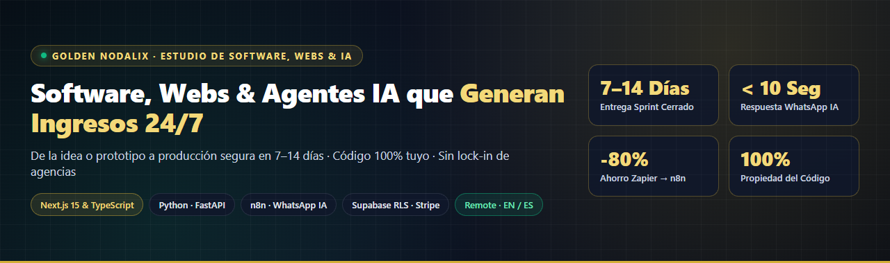
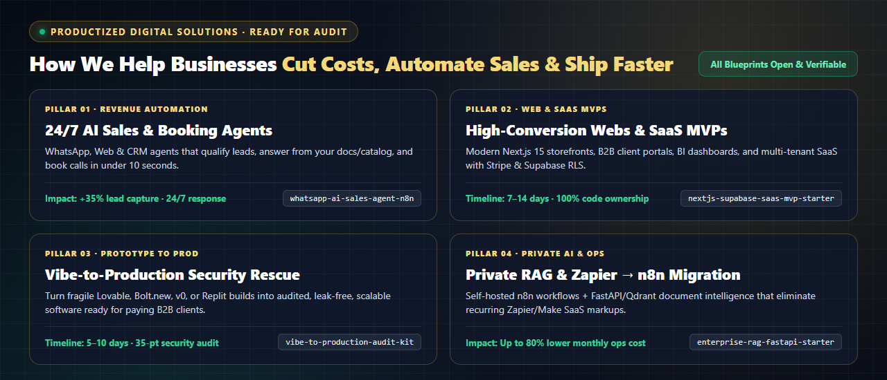

  

  

    
    
    
    
  

  

    
    
    
  

---

### Sistemas Digitales, Webs de Alta Conversión y Agentes IA 24/7 — **Golden Nodalix**

Ayudamos a **negocios, agencias B2B y fundadores** a convertir cuellos de botella manuales en sistemas digitales que captan clientes y reducen costos operativos en **7–14 días** — sin burocracia de agencias lentas ni dependencia de suscripciones caras.

> **Por qué los clientes verifican nuestro GitHub antes de contratar en LinkedIn, Fiverr o WhatsApp:** Cada solución se entrega con **100% propiedad del código**, seguridad en base de datos (**PostgreSQL / Supabase RLS**), pruebas automatizadas y costos de infraestructura transparentes.

  

---

### Servicios Digitales Productizados y Blueprints Auditables

| # | Problema de Negocio Resuelto | Resultado e Impacto Medible | Entrega | Repositorio Live |
| :-: | :--- | :--- | :---: | :--- |
| **1** | **Leads perdidos por respuesta lenta** | Agente IA 24/7 en WhatsApp/CRM (<10s, cotización con RAG, Redis dedupe y Cal.com). | **7–10 días** | [`whatsapp-ai-sales-agent-n8n`](https://github.com/agenciaiaonline-wq/whatsapp-ai-sales-agent-n8n) |
| **2** | **Lanzar SaaS o Portal de Clientes** | Next.js 15 App Router multi-tenant + TypeScript + Supabase RLS + RBAC + Stripe. | **7–14 días** | [`nextjs-supabase-saas-mvp-starter`](https://github.com/agenciaiaonline-wq/nextjs-supabase-saas-mvp-starter) |
| **3** | **App de Lovable/Bolt/v0/Replit estancada** | Rescate de 35 puntos: cerramos tablas expuestas, movemos API keys y blindamos CI. | **5–10 días** | [`vibe-to-production-audit-kit`](https://github.com/agenciaiaonline-wq/vibe-to-production-audit-kit) |
| **4** | **Operación sin métricas en tiempo real** | Portal B2B y Dashboard BI con tracking MRR/SLA y API JSON tipada. | **7–14 días** | [`nextjs-b2b-bi-dashboard-starter`](https://github.com/agenciaiaonline-wq/nextjs-b2b-bi-dashboard-starter) |
| **5** | **PDFs manuales y docs dispersos** | RAG privado con FastAPI + Qdrant, citas verificables y extracción JSON estructurada. | **10–14 días** | [`enterprise-rag-fastapi-starter`](https://github.com/agenciaiaonline-wq/enterprise-rag-fastapi-starter) |
| **6** | **Facturas altas en Zapier / Make** | Migración a n8n self-hosted en Docker reduciendo hasta **80%** el gasto mensual. | **5–10 días** | [`high-ticket-ai-automation-catalog`](https://github.com/agenciaiaonline-wq/high-ticket-ai-automation-catalog) |
| **7** | **Operación DevOps Autónoma 24/7** | Claude Code CLI + Hermes Agent + OmniRoute failover + Watchdog + Playwright CDP. | **A medida** | [`claude-code-hermes-24-7-automation`](https://github.com/agenciaiaonline-wq/claude-code-hermes-24-7-automation) |
| **8** | **Prospección manual de leads B2B** | Cazador RSS/Atom multi-fuente, scoring ICP 0–100 y CRM SQLite WAL con digest. | **7–10 días** | [`ai-lead-gen-crm-pipeline`](https://github.com/agenciaiaonline-wq/ai-lead-gen-crm-pipeline) |
| **9** | **Estandarización de equipos con IA** | Subagentes Claude Code, skills de entrega, slash commands y hooks anti-secretos. | **Habilitación** | [`claude-code-agency-toolkit`](https://github.com/agenciaiaonline-wq/claude-code-agency-toolkit) |

---

### Modelos de Trabajo y Garantía Cero Riesgo

- **1. Diagnóstico Gratuito (15 min):** Evaluamos tu embudo, web o procesos y te entregamos un roadmap con presupuesto cerrado y ROI estimado.
- **2. Sprint Cerrado (7–14 Días):** Entrega llave en mano en tu propio GitHub y servidor, con verificación automática y documentación clara.
- **3. Retainer SLA Opcional (`$500 – $4,000/mes`):** Monitoreo 24/7, optimización de costos IA o sprints continuos de producto.
- **Garantía Cero Lock-in:** **100% propiedad del código fuente** y automatizaciones desde el primer día.

---

### Disponibilidad y Contacto Directo

> **Disponibilidad Actual:** **2 cupos abiertos** este mes para sprints productivos (Remoto Mundial · Español e Inglés).

- **Portafolio Web & Calculadora ROI:** [agenciaiaonline-wq.github.io](https://agenciaiaonline-wq.github.io)
- **WhatsApp Directo (Respuesta <15 min):** [wa.me/51906135229](https://wa.me/51906135229?text=Hola%20Golden%20Nodalix%2C%20vi%20tu%20GitHub%20y%20quiero%20una%20auditoria) (`+51 906 135 229`)
- **Perfil de LinkedIn:** [Golden Nodalix en LinkedIn](https://www.linkedin.com/in/agency-golden-nodalix-880598438/)
- **Correo y Fiverr:** [`agencia.ia.online@gmail.com`](mailto:agencia.ia.online@gmail.com) · [fiverr.com/agencia_nodalix](https://www.fiverr.com/agencia_nodalix)
