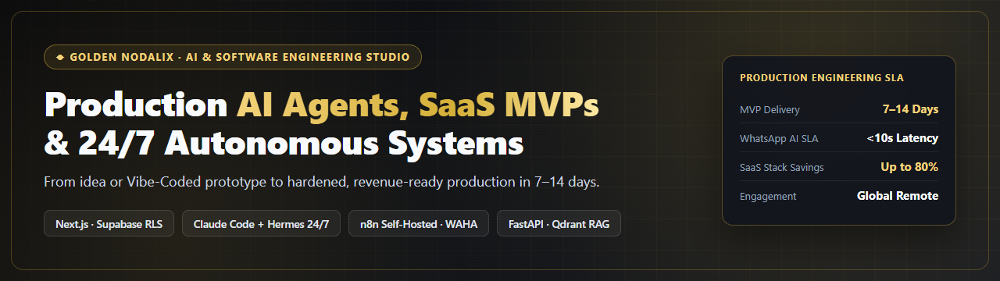

  

  

    
    
    
    
  

  

    
    
    
  

---

### Estudio de Ingeniería de Software e IA Productiva — **Golden Nodalix**

Ayudamos a **fundadores, agencias B2B y empresas** a lanzar MVPs SaaS productivos, rescatar prototipos hechos con IA (*Vibe Coding*) y desplegar agentes autónomos 24/7 en **7–14 días** — con propiedad total del código fuente y costos mensuales predecibles.

> **¿Por qué revisar nuestro GitHub antes de contratar en Fiverr, WhatsApp, Messenger o Telegram?** Cada proyecto se entrega con arquitectura verificable, seguridad real en base de datos (PostgreSQL / Supabase RLS), recuperación automática ante fallos y desglose claro de costos cloud.

---

### Catálogo de Soluciones High-Ticket & Retainers

| # | Solución | Entregable y Resultado de Negocio | Inversión Referencial | Repositorio Blueprint |
| :-: | :--- | :--- | :--- | :--- |
| **1** | **MVPs SaaS & Micro-SaaS (7–14 días)** | Plataformas multi-tenant en Next.js + TypeScript + Supabase RLS + RBAC + suscripciones Stripe listas para cobrar. | **\$5,000 – \$15,000** | [`nextjs-supabase-saas-mvp-starter`](https://github.com/agenciaiaonline-wq/nextjs-supabase-saas-mvp-starter) |
| **2** | **Rescate Vibe-to-Production (5–10 días)** | Blindaje de apps creadas en Lovable, Bolt.new, v0 o Replit: cierre de tablas expuestas, llaves API al servidor y Stripe estable. | **\$3,000 – \$8,000** | [`vibe-to-production-audit-kit`](https://github.com/agenciaiaonline-wq/vibe-to-production-audit-kit) |
| **3** | **Agentes Comerciales IA 24/7 (WhatsApp/CRM)** | Stack n8n Self-Hosted + WAHA + Redis + PostgreSQL + Cal.com: respuesta en `<10s`, cualificación y agenda automática. | **\$3,500 – \$10,000** + mensualidad | [`whatsapp-ai-sales-agent-n8n`](https://github.com/agenciaiaonline-wq/whatsapp-ai-sales-agent-n8n) |
| **4** | **Ecosistema Autónomo 24/7 (Claude + Hermes)** | Guía paso a paso de Hermes Agent + Claude Code CLI + OmniRoute Gateway con failover, Watchdog y Playwright CDP. | Arquitectura a medida | [`claude-code-hermes-24-7-automation`](https://github.com/agenciaiaonline-wq/claude-code-hermes-24-7-automation) |
| **5** | **RAG Corporativo Privado & PDFs** | Búsqueda híbrida FastAPI + Qdrant/pgvector con citas verificables y extracción JSON de facturas y contratos. | **\$4,500 – \$12,000** | [`private-corporate-rag-fastapi`](https://github.com/agenciaiaonline-wq/private-corporate-rag-fastapi) |
| **6** | **Migración n8n (-80% SaaS) & Retainers** | Transición Zapier/Make → Docker n8n propio + planes mensuales de soporte, monitoreo SLA y mejoras continuas. | **\$500 – \$4,000/mes** | [`high-ticket-ai-automation-catalog`](https://github.com/agenciaiaonline-wq/high-ticket-ai-automation-catalog) |

---

### ¿Listo para Lanzar, Rescatar o Automatizar tu Negocio?

- **LinkedIn Oficial:** [Golden Nodalix en LinkedIn](https://www.linkedin.com/in/agency-golden-nodalix-880598438/)
- **Canales Activos (Fiverr · WhatsApp · Messenger · Telegram):** Escríbenos directamente dentro de nuestra conversación activa o vía LinkedIn DM con `"MVP"` o `"AUDIT"` para iniciar una evaluación técnica de 72 horas.
