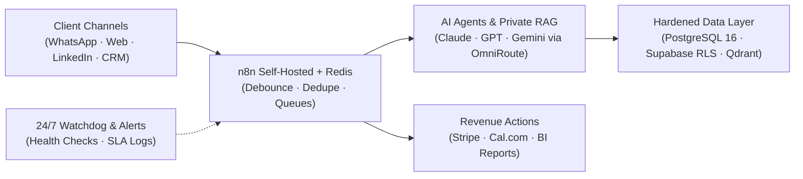

  

  

    
    
    
    
  

  

    
    
    
  

---

### Digital Systems, High-Conversion Webs & 24/7 AI Agents Built to Sell & Scale — **Golden Nodalix**

We help **businesses, B2B agencies, and startup founders** turn slow manual bottlenecks into revenue-generating digital systems in **7–14 days** — without agency bloat, per-task Zapier taxes, or fragile prototype lock-in.

> **Why clients audit our GitHub before hiring on LinkedIn, Fiverr, or WhatsApp:** Every system below ships with **100% source code ownership**, hardened database security (**PostgreSQL / Supabase RLS**), automated tests, and transparent cloud costs.

  

---

### Productized Digital Services & Auditable Blueprints

| # | Business Bottleneck Solved | Outcome & Measurable ROI | Delivery | Live Blueprint |
| :-: | :--- | :--- | :---: | :--- |
| **1** | **Slow WhatsApp / Web Lead Replies** | 24/7 AI sales & booking agent (<10s reply, RAG quoting, Redis dedupe, Cal.com sync). | **7–10 days** | [`whatsapp-ai-sales-agent-n8n`](https://github.com/agenciaiaonline-wq/whatsapp-ai-sales-agent-n8n) |
| **2** | **SaaS Idea or Legacy Portal** | Multi-tenant Next.js 15 App Router + TypeScript + Supabase RLS + RBAC + idempotent Stripe. | **7–14 days** | [`nextjs-supabase-saas-mvp-starter`](https://github.com/agenciaiaonline-wq/nextjs-supabase-saas-mvp-starter) |
| **3** | **Lovable / Bolt / v0 / Replit App Stuck** | 35-point security & architecture rescue: close open RLS tables, secure API keys, stabilize CI. | **5–10 days** | [`vibe-to-production-audit-kit`](https://github.com/agenciaiaonline-wq/vibe-to-production-audit-kit) |
| **4** | **Blind Ops & Manual Reporting** | Executive B2B Ops Portal & Real-Time BI Dashboard with MRR/SLA tracking & typed JSON API. | **7–14 days** | [`nextjs-b2b-bi-dashboard-starter`](https://github.com/agenciaiaonline-wq/nextjs-b2b-bi-dashboard-starter) |
| **5** | **Unstructured PDFs & Internal Docs** | Private FastAPI + Qdrant RAG search with verified page citations & Pydantic JSON extraction. | **10–14 days** | [`enterprise-rag-fastapi-starter`](https://github.com/agenciaiaonline-wq/enterprise-rag-fastapi-starter) |
| **6** | **High Zapier / Make Monthly Bills** | Self-hosted n8n on Docker + ROI calculator cutting recurring automation bills up to **80%**. | **5–10 days** | [`high-ticket-ai-automation-catalog`](https://github.com/agenciaiaonline-wq/high-ticket-ai-automation-catalog) |
| **7** | **Autonomous 24/7 AI Engineering Ops** | Claude Code CLI + Hermes Agent + OmniRoute auto-failover gateway + Watchdog + Playwright CDP. | **Custom** | [`claude-code-hermes-24-7-automation`](https://github.com/agenciaiaonline-wq/claude-code-hermes-24-7-automation) |
| **8** | **Manual Lead Prospecting & Triage** | Multi-source RSS/Atom signal hunter, 0–100 ICP budget scorer & WAL SQLite CRM digest. | **7–10 days** | [`ai-lead-gen-crm-pipeline`](https://github.com/agenciaiaonline-wq/ai-lead-gen-crm-pipeline) |
| **9** | **AI Dev Team Standardization** | Modular Claude Code subagents, delivery skills, slash commands & zero-secret pre-commit hooks. | **Enablement** | [`claude-code-agency-toolkit`](https://github.com/agenciaiaonline-wq/claude-code-agency-toolkit) |

---

### How Our Production Systems Work

---

### Core Engineering Stack

| Layer | Technologies |
| :--- | :--- |
| **Web, Portals & UI** |     |
| **Backend, Auth & Data** |      |
| **AI Agents & Automation** |     |

---

### Engagement Models & Risk-Reversal Guarantee

- **1. Free 15-Minute Growth & Architecture Audit:** Tell us your bottleneck and get a fixed-scope roadmap + ROI estimate before spending a dollar.
- **2. Fixed-Scope Sprint (7–14 Days):** Turnkey production delivery in your own GitHub & cloud with automated checks and clean documentation.
- **3. Optional Monthly SLA & Growth Retainer (`$500 – $4,000/mo`):** Uptime monitoring, prompt/model cost tuning, or continuous feature sprints.
- **Zero Lock-In Guarantee:** **100% source code ownership** on your repositories and self-hosted Docker stacks from day one.

---

### Availability & Direct Channels

> **Current Availability:** Booking **2 client sprint slots** this month (Remote Worldwide · English & Spanish).

- **Live Portfolio & ROI Calculator:** [agenciaiaonline-wq.github.io](https://agenciaiaonline-wq.github.io)
- **WhatsApp Direct (Fastest Reply <15 min):** [wa.me/51906135229](https://wa.me/51906135229?text=Hi%20Golden%20Nodalix%2C%20I%20saw%20your%20GitHub%20and%20want%20an%20audit) (`+51 906 135 229`)
- **LinkedIn Profile:** [Golden Nodalix on LinkedIn](https://www.linkedin.com/in/golden-nodalix/)
- **Email & Fiverr:** [`agencia.ia.online@gmail.com`](mailto:agencia.ia.online@gmail.com) · [fiverr.com/agencia_nodalix](https://www.fiverr.com/agencia_nodalix)
