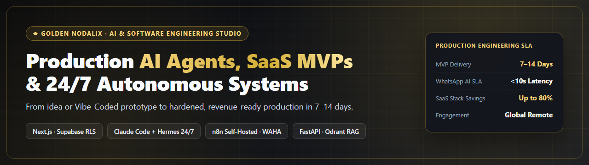
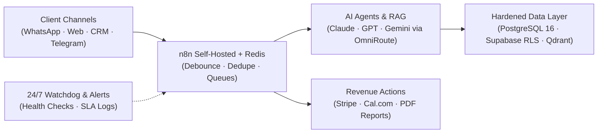

  

  

    
    
    
    
  

  

    
    
    
  

---

### Production AI Engineering & Rapid MVP Studio — **Golden Nodalix**

We help **founders, B2B agencies, and growing companies** ship production-ready SaaS MVPs, rescue unstable AI/Vibe-Coded prototypes, and deploy autonomous 24/7 AI sales & workflow systems in **7–14 days** — without agency bloat or fragile no-code lock-in.

> **Why teams verify our GitHub before hiring on Fiverr, LinkedIn, WhatsApp, Messenger, or Telegram:** Every repository below ships with clean source code ownership, database security (PostgreSQL/Supabase RLS), automated unit tests & CI checks, and transparent infrastructure costs.

---

### High-Ticket Productized Services & Live Repositories

| # | Solution | Scope & Business Outcome | Reference Investment | Blueprint Repo |
| :-: | :--- | :--- | :--- | :--- |
| **1** | **14-Day SaaS & Micro-SaaS MVP** | Multi-tenant Next.js 15 App Router + TypeScript + Supabase RLS + RBAC + idempotent Stripe webhooks. | **\$5,000 – \$15,000** *(7–14 days)* | [`nextjs-supabase-saas-mvp-starter`](https://github.com/agenciaiaonline-wq/nextjs-supabase-saas-mvp-starter) |
| **2** | **Vibe-to-Production Security Rescue** | Python audit CLI & RLS checks for Lovable, Bolt.new, v0, or Replit apps: close open tables, move leaked keys, stabilize CI. | **\$3,000 – \$8,000** *(5–10 days)* | [`vibe-to-production-audit-kit`](https://github.com/agenciaiaonline-wq/vibe-to-production-audit-kit) |
| **3** | **24/7 WhatsApp & CRM AI Sales Engine** | Self-hosted n8n + WAHA + Redis `EX 300` dedupe + PostgreSQL + Cal.com: sub-10s replies, RAG quoting & auto-booking. | **\$3,500 – \$10,000** + retainer | [`whatsapp-ai-sales-agent-n8n`](https://github.com/agenciaiaonline-wq/whatsapp-ai-sales-agent-n8n) |
| **4** | **Autonomous Multi-Agent DevOps (24/7)** | Claude Code CLI + Hermes Agent + OmniRoute auto-failover gateway + Watchdog + Playwright CDP. | Custom Architecture | [`claude-code-hermes-24-7-automation`](https://github.com/agenciaiaonline-wq/claude-code-hermes-24-7-automation) |
| **5** | **Enterprise RAG & PDF Extraction API** | FastAPI + Qdrant/pgvector multi-tenant retrieval with verified page citations & structured JSON invoice extraction. | **\$4,500 – \$12,000** | [`enterprise-rag-fastapi-starter`](https://github.com/agenciaiaonline-wq/enterprise-rag-fastapi-starter) |
| **6** | **Claude Code Agency Toolkit** | Modular subagents, delivery skills, slash commands, pre-commit secret hooks & sanitized MCP server configs. | Team Enablement | [`claude-code-agency-toolkit`](https://github.com/agenciaiaonline-wq/claude-code-agency-toolkit) |
| **7** | **AI Lead Gen & SQLite CRM Pipeline** | Multi-source RSS/Atom opportunity hunter, 0–100 ICP budget scorer, WAL SQLite CRM & Markdown/CSV digest exporter. | **\$3,500 – \$9,500** | [`ai-lead-gen-crm-pipeline`](https://github.com/agenciaiaonline-wq/ai-lead-gen-crm-pipeline) |
| **8** | **Zapier/Make → n8n Migration & Catalog** | Cut recurring SaaS automation costs up to **80%** on Docker + standardized SOWs, SLA retainers & Python ROI CLI. | **\$500 – \$4,000/mo** retainer | [`high-ticket-ai-automation-catalog`](https://github.com/agenciaiaonline-wq/high-ticket-ai-automation-catalog) |
| **9** | **B2B Ops Portal & Real-Time BI Dashboard** | Executive KPI telemetry, MRR/SLA tracking & filtered JSON API in Next.js 15 + TypeScript. | **\$4,000 – \$12,000** *(7–14 days)* | [`nextjs-b2b-bi-dashboard-starter`](https://github.com/agenciaiaonline-wq/nextjs-b2b-bi-dashboard-starter) |

---

### How Our Production Systems Work

---

### Core Engineering Stack

| Layer | Technologies |
| :--- | :--- |
| **Frontend & Apps** |     |
| **Backend & Data** |      |
| **AI & Automation** |     |

---

### Engagement Models & Monthly Retainers

- **72-Hour Architecture & Cost Audit:** Security audit (RLS/Auth/API keys), infrastructure budget breakdown, and execution roadmap before committing to a full build.
- **Fixed-Scope Sprint (7–14 Days):** Turnkey delivery with full repository ownership, Docker/CI setup, and live verification.
- **Monthly Growth & SLA Retainer (`$500 – $4,000/mo`):**
  - *Tier 1 — Uptime & API Health (`$500–$800/mo`):* 24/7 monitoring, model/webhook maintenance, minor adjustments.
  - *Tier 2 — Active Feature Partner (`$1,500–$2,500/mo`):* Continuous vibe-coded feature sprints, prompt tuning, token cost reduction.
  - *Tier 3 — Fractional AI CTO (`$3,500+/mo`):* Multi-agent roadmap ownership, weekly strategy, dedicated engineering throughput.

---

### Ready to Launch, Rescue, or Automate?

- **LinkedIn Portfolio & Direct Message:** [Golden Nodalix on LinkedIn](https://www.linkedin.com/in/agency-golden-nodalix-880598438/)
- **Pricing & ROI Catalog:** [`BLUEPRINTS.md`](BLUEPRINTS.md) · [`high-ticket-ai-automation-catalog`](https://github.com/agenciaiaonline-wq/high-ticket-ai-automation-catalog)
- **Active Channels (Fiverr · WhatsApp · Messenger · Telegram):** Reply directly in our active chat thread or send `"MVP"` / `"AUDIT"` via LinkedIn to start a 72-hour technical scope audit.
